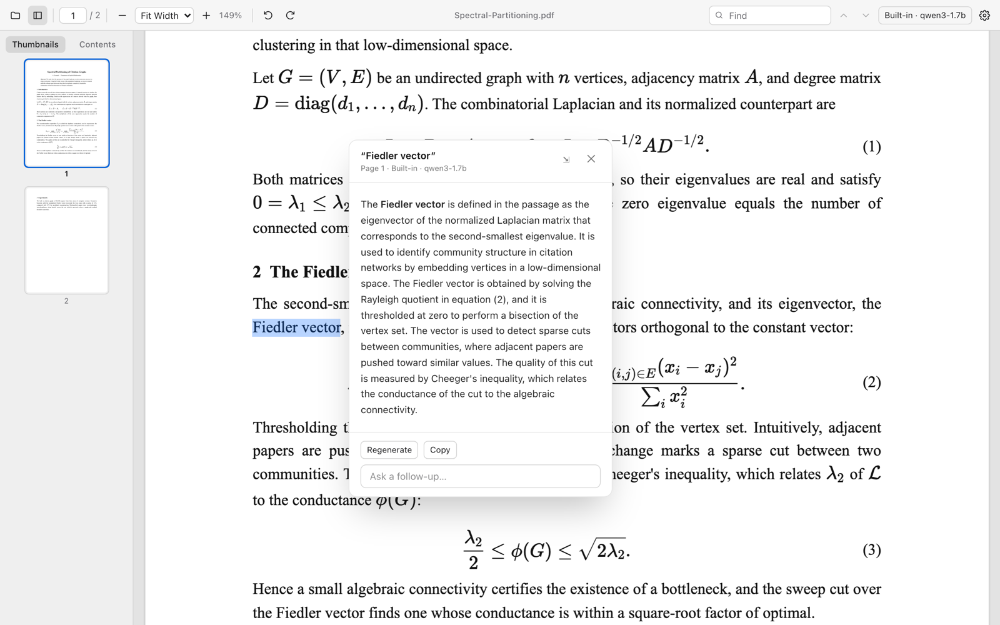
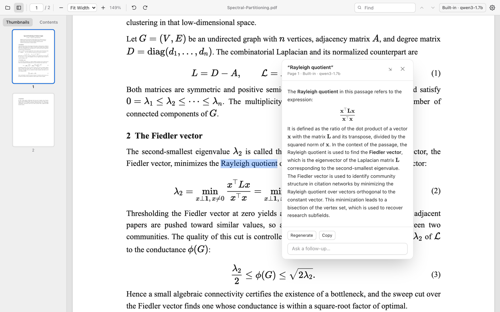

# Query PDF

I built this because, while reading textbooks and research papers, I couldn't find a PDF reader that let me look up what a term means without leaving the app. Query PDF lets you highlight a word or sentence and get an explanation based on the text around it.





## What it does

- A PDF viewer with thumbnails, an outline sidebar, search, zoom and rotate
- Highlight text and press **Explain** (⌘/Ctrl+E). The surrounding sentences are sent to an LLM, so the explanation fits the passage, not just a dictionary definition
- Ask follow-up questions in the same panel. Math is rendered with LaTeX
- Choose the model in Settings:
  - **Built-in**: a small Qwen3 model that runs offline on your computer (one-time download)
  - **Ollama**: any model you already run locally
  - **Cloud**: OpenAI, Anthropic, Gemini or any OpenAI-compatible API. Keys are stored in your system keychain

Runs on macOS, Windows and Linux.

## Build

Requires Node 20+, Rust, and the [Tauri prerequisites](https://tauri.app/start/prerequisites/).

```bash
npm install
npm run fetch-sidecar   # downloads llama.cpp's llama-server for the built-in model
npm run tauri dev       # run
npm run tauri build     # make an installer
```

## Test

```bash
npm test
cd src-tauri && cargo test --lib
```
